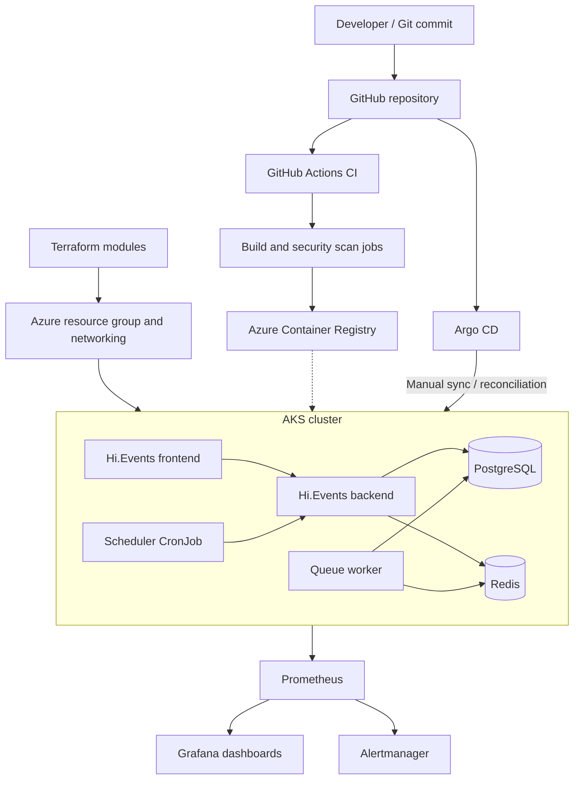

<h1 align="center">Aegis Platform</h1>

<p align="center">
  <strong>Building a resilient Kubernetes application platform on Microsoft Azure with Terraform, Helm, GitHub Actions, Argo CD and a complete monitoring stack.</strong>
</p>

<p align="center">
  A platform engineering project focused on repeatable infrastructure, controlled software delivery, operational visibility and measurable workload resilience.
</p>

<p align="center">
  
  
  
  
  
  
  
  
  
  
  
</p>

<p align="center">
  <a href="#architecture">Architecture</a> ·
  <a href="#infrastructure-as-code">Infrastructure</a> ·
  <a href="#continuous-integration-and-gitops">CI and GitOps</a> ·
  <a href="#observability">Observability</a> ·
  <a href="#reliability-and-autoscaling">Reliability</a> ·
  <a href="#engineering-decisions-and-trade-offs">Engineering decisions</a>
</p>

---

## Overview

Aegis is a production-style platform engineering project built around **Hi.Events**, an open-source event management application. Rather than treating Kubernetes as the end goal, I used the application to explore the wider responsibilities involved in operating a cloud-native platform: provisioning infrastructure, deploying dependent services, managing configuration, separating build and deployment responsibilities, observing system behaviour and testing recovery under load.

The platform runs on **Azure Kubernetes Service (AKS)**. Its Azure infrastructure is defined in **Terraform**, application workloads are packaged and configured through **Helm**, **GitHub Actions** runs the continuous integration workflow and **Argo CD** reconciles the application with its configuration in Git. **Prometheus, Grafana and Alertmanager** provide the foundations for monitoring and alerting.

This is a **development and demonstration environment**, designed using practices relevant to production systems. It is not presented as a live, highly available commercial service. Where a capability has been tested, the results are recorded below. Where it remains a potential improvement, it is identified as such.

### What I built

| Area | Implementation | Engineering purpose |
| --- | --- | --- |
| Cloud infrastructure | Azure resource group, networking, AKS, Azure Container Registry and managed identity | Establish a repeatable foundation for container workloads |
| Infrastructure as Code | Terraform environment and reusable networking, AKS and ACR modules | Keep infrastructure changes reviewable and reproducible |
| Application platform | Hi.Events frontend, backend, PostgreSQL, Redis, queue worker and scheduled jobs | Run an application with multiple interconnected components |
| Workload configuration | Kubernetes Deployments, Services, StatefulSet, persistent storage and ConfigMaps | Manage application lifecycle, networking and state |
| Application packaging | Helm charts and environment-specific configuration | Reduce repeated YAML and centralise deployment settings |
| Continuous integration | GitHub Actions build and security scan jobs for frontend and backend | Check application artefacts before delivery |
| GitOps | Argo CD application tracking Git, with manual synchronisation | Make Git the declared source of deployment configuration |
| Monitoring | Prometheus, Grafana, Alertmanager and Kubernetes exporters | Observe workloads and investigate resource consumption |
| Reliability | Readiness and liveness probes, resource requests and limits, HPA | Test recovery and response to changing demand |

## Architecture

The design separates infrastructure provisioning, image build and application reconciliation. Terraform manages Azure resources. Kubernetes runs the workloads. GitHub Actions provides CI checks and Argo CD handles the GitOps deployment path.



> **Architecture note:** The diagram shows the main components and their responsibilities. It is a logical view rather than a complete representation of every network route, permission or Kubernetes object. The dotted registry connection represents the image supply path, not a claim that every image publication is automatically deployed.

### Azure infrastructure

The Azure environment is defined under `terraform/environments/dev`, with reusable modules under `terraform/modules`.

- **Networking module:** virtual network, subnet and supporting network resources.
- **AKS module:** managed Kubernetes cluster configuration and identity integration.
- **ACR module:** Azure Container Registry for container image storage.
- **Environment composition:** brings the modules together and passes their outputs to dependent resources.


*Azure resource group showing the infrastructure created for the development platform. Subscription identifiers should be redacted before publishing the screenshot.*

## Infrastructure as Code

I chose Terraform to make the Azure environment explicit in source control rather than relying on a sequence of portal changes. The modules separate concerns so that networking, registry and cluster configuration can be reviewed independently.

```text
terraform/
├── environments/
│   └── dev/
│       ├── main.tf
│       ├── variables.tf
│       └── .terraform.lock.hcl
└── modules/
    ├── networking/
    ├── aks/
    └── acr/
```

The environment consumes module outputs to connect resources. For example, the AKS module needs network information from the networking module. This expresses the dependency in code and makes the intended relationship easier to understand during review.

### State and configuration hygiene

Terraform state can contain infrastructure details and sensitive values. The repository therefore excludes local state, state backups, variable-value files and provider working directories through `.gitignore`. The provider lockfile is committed to help make provider selection consistent.

```gitignore
**/.terraform/
**/*.tfstate
**/*.tfstate.*
**/*.tfvars
**/*.tfvars.json
```

The checked-in code is intended to describe the infrastructure without publishing local state or private configuration. For a shared production environment, I would extend this with a remote state backend, controlled access and a formal plan-and-apply approval process.

## Kubernetes application platform

Hi.Events is a useful platform workload because it involves more than a single stateless web container. The application needs a frontend, backend API, database, cache, background worker and scheduled processing. Deploying those components together requires service discovery, configuration, storage and lifecycle management.

| Component | Kubernetes workload | Responsibility |
| --- | --- | --- |
| Frontend | Deployment and Service | User-facing application on port `5678` |
| Backend | Deployment and Service | Application API on port `8080` |
| PostgreSQL | StatefulSet, Service and persistent volume claim | Relational application data |
| Redis | Deployment and Service | Cache and queue-related communication |
| Queue worker | Deployment | Background job processing |
| Scheduler | CronJob | Scheduled application tasks |

The workloads run in the `aegis` namespace. Internal Kubernetes Services provide stable names for communication between components, avoiding dependencies on individual pod IP addresses.


*Workload inspection showing the application's running pods, Deployments, StatefulSet and Services. Completed scheduler jobs are expected for a CronJob. Pod restarts require their own investigation and should not be treated as proof of health.*

### Configuration and secrets

Non-sensitive application settings are separated into ConfigMaps. Sensitive values are consumed through Kubernetes Secret references such as `secretKeyRef`, rather than being written directly into Deployment definitions.

This improves separation of concerns, although Kubernetes Secrets alone are not a complete secrets-management solution. A more mature environment would use a managed secret store, identity-based access and a documented rotation process.

### Helm and release configuration

The repository also contains Helm-based application configuration. Helm provides a reusable deployment interface for related Kubernetes resources and supports changing settings through values rather than editing each manifest by hand.

The `kubernetes/base` directory documents the underlying resource definitions and earlier implementation. **The Helm and GitOps configuration is the intended deployment path**, so changes to the running application should be made through the source Argo CD tracks rather than by editing live resources and allowing them to drift.

## Continuous integration and GitOps

### GitHub Actions: build and security checks

The workflow **Aegis CI - Build and Security Scan** runs separate frontend and backend jobs. A successful recorded workflow run completed both jobs and produced build artefacts. This gives a visible check of the application build path before configuration is reconciled into the cluster.


*Successful GitHub Actions workflow showing the frontend and backend jobs. A green workflow indicates the configured jobs passed; it does not by itself establish that the deployed application passed an end-to-end test.*

The separation between CI and deployment is deliberate. A successful build should not be confused with a successful rollout. The delivery process needs both a trustworthy artefact and a controlled change to the desired Kubernetes configuration.

### Argo CD: Git as the deployment source

Argo CD manages the `aegis-dev` application and displays the difference between the declared configuration in Git and the resources running in Kubernetes. The application was observed in **Synced** and **Healthy** states during the project review.


*Argo CD resource tree for `aegis-dev`. Personal email addresses or other identifying metadata should be redacted before publishing.*

For this environment, **automatic synchronisation is disabled**. Changes can be reviewed and then synchronised manually. This makes the deployment step explicit and helps distinguish a Git commit from an actual cluster change.

Argo CD provides visibility into desired versus observed state, but a healthy application indicator is not a substitute for testing business functionality, database connectivity or external availability.

## Observability

A platform is difficult to operate without a clear view of what its workloads are doing. I installed the Kubernetes monitoring stack with **Prometheus, Grafana and Alertmanager**, alongside the supporting exporters and operator components.

### Prometheus and scrape targets

Prometheus collects metrics from Kubernetes and the monitoring components. During validation, the visible target page showed healthy **UP** targets, including the API server, CoreDNS, Grafana and Alertmanager.


*Prometheus targets page showing the health of the visible scrape endpoints. This confirms those targets were reachable at the time of inspection, not that every possible target was healthy.*

### Grafana: workload-level visibility

I used the **Kubernetes / Compute Resources / Namespace (Pods)** dashboard filtered to the `aegis` namespace. This provided visibility into CPU and memory use across the application workloads, including the response during a controlled frontend load test.


*Grafana namespace dashboard showing resource consumption and the increase in CPU during load testing.*

The dashboard showed memory usage above the configured requests for some workloads. This is an important distinction: **a request is a scheduling reservation, not a hard memory ceiling**. Memory limits and actual working-set usage need to be assessed separately. Metrics like these help identify whether requests are representative of real demand and whether workloads need tuning.

### What I would monitor next

The monitoring stack establishes the technical foundation. The next operational step would be to define service-level signals and actionable alerts, for example sustained pod unavailability, repeated restarts, CPU throttling, memory pressure, persistent volume capacity and failed application requests. Alert rules should be tested for signal quality rather than added solely to increase dashboard coverage.

## Reliability and autoscaling

The most valuable part of Aegis was moving beyond a deployment that simply starts and testing how Kubernetes behaves when pods are replaced or resource demand changes.

### Readiness and liveness probes

I configured HTTP probes for both the frontend and backend. The frontend probes use port `5678`, while the backend uses port `8080`.

| Probe | Endpoint | Initial delay | Period | Timeout | Failure threshold |
| --- | --- | --- | --- | --- | --- |
| Readiness | HTTP `/` | 10 seconds | 10 seconds | 3 seconds | 3 |
| Liveness | HTTP `/` | 30 seconds | 20 seconds | 3 seconds | 3 |

Readiness probes determine whether a pod should receive Service traffic. Liveness probes allow Kubernetes to restart a container that repeatedly fails its health check. These are related but different responsibilities.


*Frontend Deployment configuration showing probe settings and CPU and memory requests and limits.*


*Backend probe configuration. Include this image only if the corresponding screenshot was saved.*

**Limitation:** The `/` endpoint is a basic HTTP check. It does not verify every application dependency or guarantee that a user can complete a full event-management workflow. A dedicated readiness endpoint that checks critical dependencies would provide a stronger signal.

### Pod replacement and self-healing

I deliberately deleted a frontend pod to observe how its Deployment and ReplicaSet restored the desired replica count. In the recorded test, a replacement became Ready after approximately **16 seconds**.

This demonstrates Kubernetes reconciliation following a pod deletion. It is **not** a measured 16-second customer-facing outage and it is not a liveness-probe failure test. The test was performed on a development workload with a small replica count.


*ReplicaSet events showing frontend pod lifecycle activity. These events demonstrate replica management, but the screenshot does not independently establish the 16-second recovery measurement.*

### Horizontal Pod Autoscaler

I added a CPU-based **Horizontal Pod Autoscaler (HPA)** to the frontend and configured the Deployment's resource requests and limits.

| Setting | Frontend configuration |
| --- | --- |
| Minimum replicas | `1` |
| Maximum replicas | `2` |
| Target CPU utilisation | `60%` of CPU request |
| CPU request | `50m` |
| CPU limit | `250m` |
| Memory request | `192Mi` |
| Memory limit | `384Mi` |

CPU utilisation for this HPA is measured relative to the CPU request. With a `50m` request, a target of `60%` corresponds to an average of approximately `30m` CPU per pod, not 60% of a whole CPU core.

#### Controlled load test: observed behaviour

1. **Baseline:** the frontend was running with one replica.
2. **Load:** I generated concurrent HTTP requests against the frontend for approximately one minute.
3. **Scale-out:** the HPA reported CPU utilisation of **170% of request**, above the 60% target, and increased the desired replica count from **1 to 2**.
4. **Recovery:** after the load stopped, CPU utilisation dropped to approximately **4–8% of request**.
5. **Scale-in:** following the scale-down stabilisation period of roughly five minutes, the HPA reduced the frontend from **2 replicas back to 1**.

Kubernetes reported `SuccessfulRescale` events for both the increase and decrease. Following the test, Argo CD showed the application as **Synced** and **Healthy**, and the frontend returned HTTP `200`.

**Result:** the test demonstrated that the configured HPA could respond to a short period of increased CPU demand and later return to the baseline replica count. It did not establish a maximum throughput, latency service-level objective or sustained production capacity.

### Preventing Helm and HPA from fighting over replicas

An important configuration detail was ensuring that the rendered frontend Deployment did **not** declare a fixed `replicas` value when HPA was enabled. Otherwise, a reconciliation of the Deployment could overwrite the replica count selected by the autoscaler.

This is a practical example of platform engineering extending beyond individual tools: the Helm templates, Kubernetes controllers and GitOps reconciliation loop must agree on which component owns a particular field.

## Application validation

The frontend was accessed locally through a Kubernetes Service port-forward:

```bash
kubectl port-forward -n aegis svc/frontend 5678:5678
```

The application login page was then available at `http://localhost:5678/auth/login`.


*Hi.Events frontend served from the Kubernetes environment. This demonstrates that the application interface was reachable through the port-forward; it is not evidence of public ingress or a completed end-to-end transaction.*

For day-to-day troubleshooting, the key distinction is between a running pod, a Ready pod, a reachable Service and an application that can successfully perform its intended business operations. Each is a different level of validation.

## Engineering decisions and trade-offs

| Decision | Reason | Trade-off / next step |
| --- | --- | --- |
| AKS rather than self-managed Kubernetes | Focus on workload and platform operations while Azure manages the control plane | Less direct control over control-plane internals |
| Terraform modules | Separate infrastructure concerns and make changes reviewable | Requires careful state handling and dependency management |
| Helm for workload configuration | Reuse templates and maintain consistent settings | Template complexity needs validation and clear values ownership |
| Argo CD with manual sync | Make deployment reconciliation visible and intentional | Requires an operator to initiate syncs |
| One frontend replica at baseline | Keep the development environment economical while testing scaling | No guaranteed application availability during replacement |
| CPU-based HPA | Demonstrate a measurable scaling signal | CPU alone may not represent user experience or queue pressure |
| HTTP `/` probes | Establish basic process and HTTP responsiveness | Dedicated health endpoints would provide better dependency checks |
| In-cluster PostgreSQL and Redis | Exercise Kubernetes stateful and supporting workloads | Managed services and a tested backup strategy would be preferable for production |
| Local port-forward access | Validate application and observability interfaces without adding public exposure | Does not test ingress, external TLS or public availability |

### Lessons from the build

**A successful deployment is only the starting point.** A green Kubernetes status does not explain whether an application can handle load, whether a dependency is healthy or how quickly a failed workload is replaced. The probe and HPA tests provided evidence beyond simply seeing pods in a Running state.

**Controllers need clear ownership.** The HPA and Helm interaction showed why declarative systems can still conflict if multiple components try to control the same setting.

**Resource requests are operational decisions.** Requests influence scheduling and autoscaling calculations. Limits constrain resource consumption. Grafana helped connect those configuration choices to observed workload behaviour.

**CI and GitOps solve different problems.** CI checks the application build. Argo CD tracks and reconciles deployment configuration. Neither one replaces runtime monitoring or application-level testing.

## Repository structure

The repository includes the following main areas:

```text
aegis-platform/
├── .github/
│   └── workflows/             # GitHub Actions workflows
├── terraform/
│   ├── environments/dev/      # Azure development environment
│   └── modules/
│       ├── networking/        # Network resources
│       ├── aks/               # Kubernetes cluster
│       └── acr/               # Container registry
├── kubernetes/
│   └── base/                  # Kubernetes resource manifests
├── docs/
│   └── screenshots/           # Evidence used in this README
└── README.md
```

The Helm chart and Argo CD configuration are also maintained in the repository. Their precise paths should be checked against the current repository before documenting commands that reference them.

## Operational checks

These commands are useful when validating the deployed environment after obtaining the appropriate Azure and Kubernetes access:

```bash
# Confirm the current Kubernetes context before making changes
kubectl config current-context

# Inspect the application workloads
kubectl get pods,deployments,statefulsets,services -n aegis

# Check frontend health configuration and recent events
kubectl describe deployment frontend -n aegis
kubectl get events -n aegis --sort-by=.lastTimestamp

# Inspect frontend autoscaling
kubectl get hpa -n aegis
kubectl describe hpa frontend -n aegis

# Inspect GitOps application state
kubectl get applications -n argocd

# Inspect the monitoring workloads
kubectl get pods -n monitoring
```

These are inspection commands, not a complete installation runbook. Provisioning a new environment also requires Azure credentials, Terraform variables, cluster access, Helm configuration and the relevant application secrets.


## What this project demonstrates

Aegis brings together the engineering disciplines needed to support a Kubernetes application platform: **Infrastructure as Code, cloud networking, workload configuration, CI, GitOps, monitoring, troubleshooting and resilience testing**.

The most useful outcome was not simply getting Hi.Events to run on AKS. It was understanding how the pieces interact, identifying where controllers or configuration can conflict and using observed system behaviour to validate the design.

---

<p align="center">
  <strong>Built as a practical DevOps and Platform Engineering portfolio project.</strong><br />
  <a href="https://abdimajid.co.uk">Portfolio</a> ·
  <a href="https://github.com/AbdimajidHussein03">GitHub</a>
</p>
